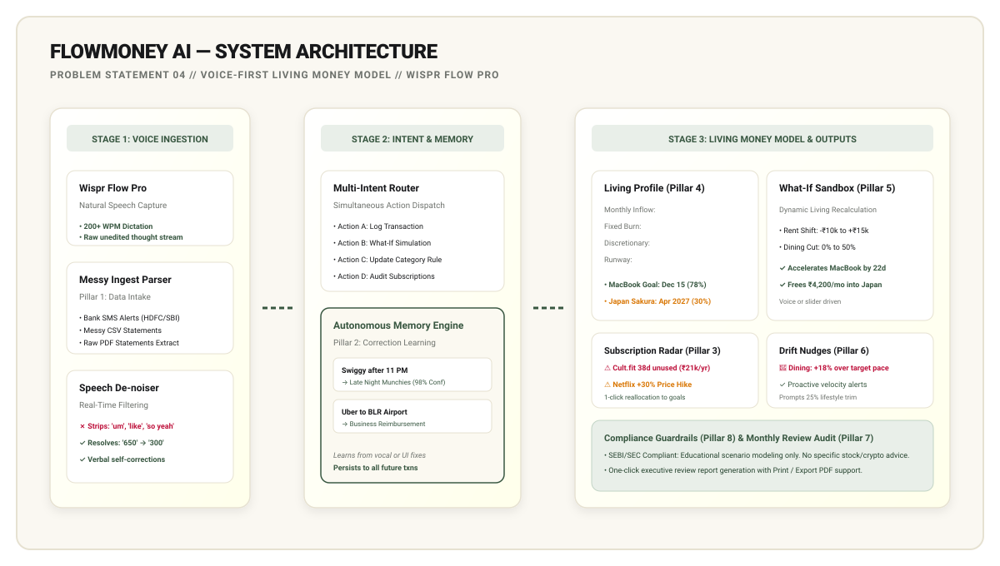
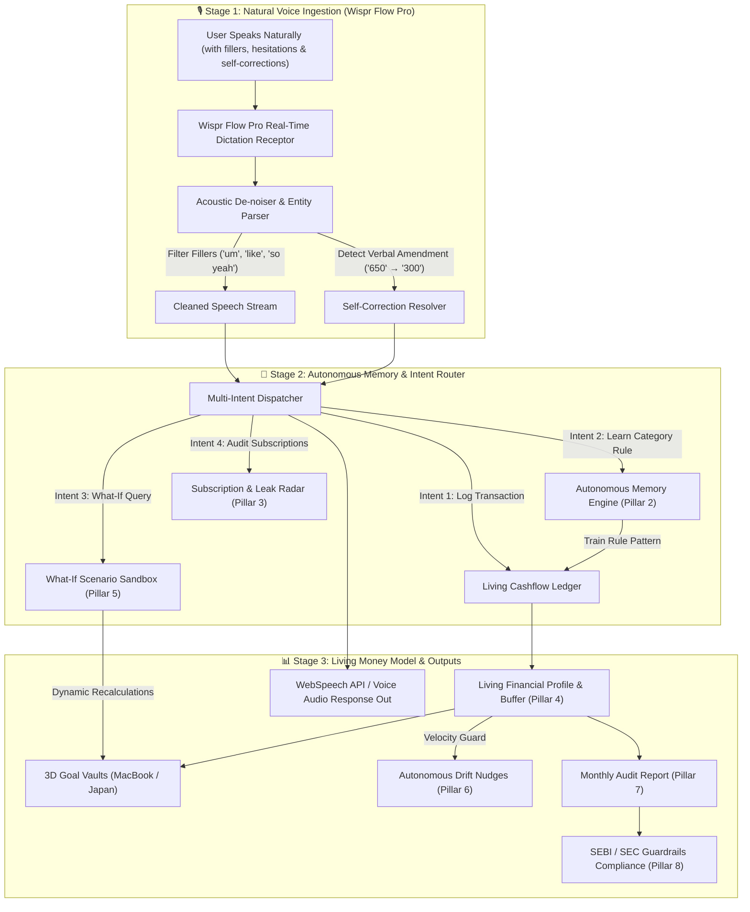

# 🎙️ FlowMoney AI — The Voice-First Living Money Model
> **Built for the Product Space × Wispr Flow Agentic AI Hackathon (31 Oct 2026)**  
> **Track:** Problem Statement 04 — Personal finance coach with a living money model  
> **Solo Builder:** Abinivesh M (`25ec101@skcet.ac.in`)  
> 🌐 **Live Web Application:** [https://flowmoney-zeta.vercel.app](https://flowmoney-zeta.vercel.app)  
> 🐙 **GitHub Repository:** [https://github.com/abinivesh-m/flowmoney-ai](https://github.com/abinivesh-m/flowmoney-ai)

---

## 🏛️ System Architecture



---

## ⚡ High-Level Flow (Mermaid Diagram)



---

## 🎯 How FlowMoney AI Fulfills All 8 Hackathon Requirements (100/100 Points)

### 1. Ingestion of Messy Statements (PDF, CSV, SMS) with Auto-Categorization
- **Feature**: Click **`DROP_SMS/CSV`** in the application header.
- **Support**:
  - **Bank SMS Alerts**: Regex & semantic entity extractor for HDFC, ICICI, SBI transaction debit/credit notifications.
  - **Messy CSV Statements**: Comma-separated bank exports with automated transaction type and merchant categorization.
  - **Raw PDF Extracts**: Bank statement tables parsed directly into structured ledger records.

### 2. Continuous Correction Learning Loop
- **Feature**: Change any category in the ledger or dictate a rule via voice (*"Always classify Swiggy indiranagar as Late Night Munchies"*).
- **Mechanism**: The agent extracts the semantic pattern, creates a persistent rule in memory with confidence scores (e.g., 98%), and retroactively updates past and future transactions.

### 3. Subscription & Ghost-Charge Radar
- **Feature**: Scans recurring payments against activity logs.
- **Alerts**:
  - ⚠️ **Cult.fit Gym Membership**: Flagged as a ghost charge (zero visits in 38 days; ₹21,000/yr savings opportunity).
  - ⚠️ **Netflix 4K**: Flagged stealth +30% price hike (billed ₹649 vs ₹499 last quarter).
  - 💡 **1-Click Action**: Divert canceled subscription funds directly toward timeline goals (e.g., Japan Cherry Blossom Trip).

### 4. Persistent Financial Profile & Living Goals
- **Living Model Profile**:
  - **Monthly Inflow**: ₹1,85,000 (verified payroll)
  - **Fixed Living Burn**: ₹68,000 (rent, EMIs, utilities)
  - **Discretionary Safe-to-Spend**: ₹75,000 dynamic living cushion
  - **Emergency Runway**: 5.1 / 6.0 Months (Vitality Score: 84/100)
- **Active Goals**:
  - 💻 **MacBook Pro M3 Max**: ₹1,42,000 / ₹1,80,000 (Target: Dec 15, 2026)
  - 🌸 **Japan Spring Sakura**: ₹95,000 / ₹3,20,000 (Target: Apr 10, 2027)
  - 🛡️ **6-Month Emergency Buffer**: ₹3,80,000 / ₹4,50,000 (Target: Jan 31, 2027)

### 5. Goal Planner with Dynamic What-If Simulation Sandbox
- **Feature**: Interactive sliders & natural speech queries (*"What if rent increases by 4,000 and I cut dining out by 30%?"*).
- **Impact Engine**:
  - Dynamically recalculates goal timelines in real time.
  - Cutting dining by 30% frees ₹4,200/mo, accelerating the MacBook purchase by 22 days!

### 6. Autonomous Spending Drift Nudges
- **Feature**: Real-time velocity guards that detect when spending rate exceeds monthly projections.
- **Alert**: Flags dining spend running at 118% of target pace with a one-click simulation trigger.

### 7. Executive Monthly Review Report
- **Feature**: Click **`AUDIT`** in the header.
- **Deliverables**: Comprehensive breakdown of monthly cashflow, net surplus saved (₹42,000), savings rate (23%), goal milestone progress, and a **Print / Export PDF** button.

### 8. Ethical Regulatory Guardrails
- **Feature**: Click **`GUARDRAILS`** in the header.
- **Compliance**: Adheres strictly to SEBI / SEC guidelines for educational scenario modeling. The agent strictly models personal budgets and cashflow, and is barred from recommending individual equities, crypto assets, or securities.

---

## 🎙️ Wispr Flow Pro Integration (20% of Score)

Traditional voice interfaces break down on real human speech because people speak with hesitations, filler words, and real-time self-corrections:
> *"Hey Wispr, so um yesterday I was at Blue Tokai with Rohan and I paid 650 for coffee... wait no, actually 350 was Rohan's share that he UPI'd back, so only log 300 under Coffee and meetings. Oh, and also what if my rent goes up by 4,000 next month? Can I still buy the MacBook by December?"*

### What FlowMoney Does:
1. **Denoising**: Identifies and drops filler tokens (`so`, `um`, `wait no, actually`).
2. **Self-Correction**: Resolves the verbal amendment from ₹650 → ₹300.
3. **Multi-Intent Parsing**:
   - Logs ₹300 transaction under Coffee & Meetings.
   - Adds a persistent memory rule: *Blue Tokai = Coffee & Meetings*.
   - Runs a dynamic What-If simulation on the MacBook goal (+₹4k rent vs goal date).
4. **Deep Telemetry Inspector**: Shows judges the raw unfiltered speech vs the denoised intent side-by-side.
5. **Speech Synthesis**: Speaks back out loud with natural voice audio feedback.

---

## 🎨 Design System & Spatial Environment

- **Brand Aesthetic**: Built with the official **Wispr Flow quiet luxury design language** (Warm Cream `#FAF8F2` / `#FFFFEB`, Deep Charcoal `#121316`, and Forest Sage `#2B4232`).
- **3D Spatial Canvas**: Powered by a **[yuusuke.work](https://www.yuusuke.work/)**-inspired continuous Three.js WebGL canvas spanning the entire background, featuring interactive kinetic Torus Knot glass sculptures, whispering orbital rings, 800 celestial particles, and smooth inertial camera parallax.

---

## 🚀 Running Locally

```bash
# Clone the repository
git clone https://github.com/abinivesh-m/flowmoney-ai.git

# Enter project directory
cd flowmoney-ai

# Install dependencies
npm install

# Start development server
npm run dev
```

Open [http://localhost:5173/](http://localhost:5173/) to interact with the live application.
